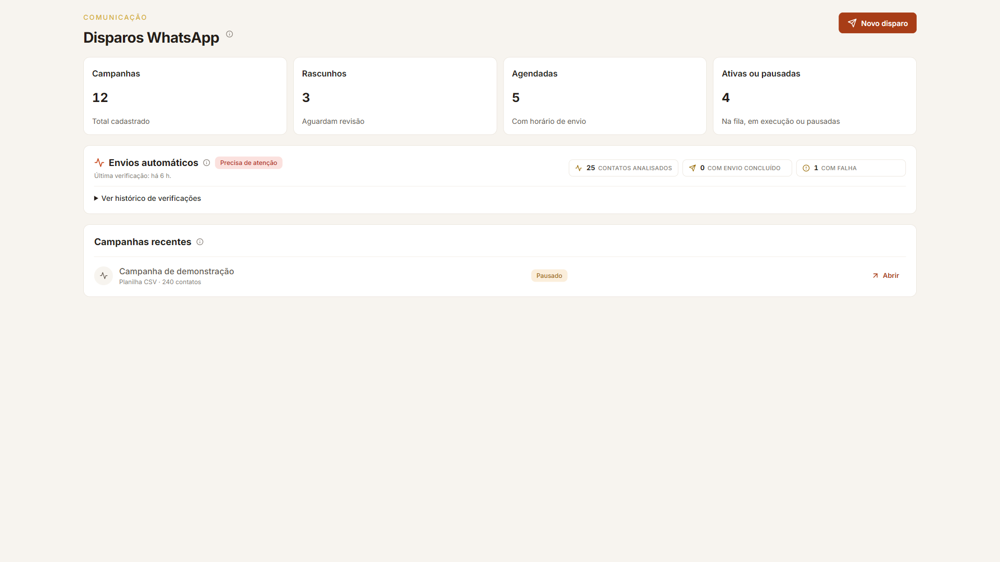

# Campanhas e disparos

A listagem de `/painel/disparos` foi comparada às referências [desktop](../../../references/desktop/page--campanhas.png) e [mobile](../../../references/mobile/page--campanhas.png). A rota real foi inspecionada em sessão autenticada; a captura dessa sessão não foi gravada porque mostra nomes e textos de campanhas. A captura salva é uma prévia com dados sintéticos e componentes reais do design system.

## Padrões preservados e refinados

- O cabeçalho da página e a ação principal continuam usando `PageHeader` e `Button`.
- Os quatro indicadores mostram `Campanhas`, `Rascunhos`, `Agendadas` e `Ativas ou pausadas`, exatamente os totais entregues pelo serviço. Os números de mensagens entregues e taxa de resposta da referência são demonstrativos e não existem como totais confiáveis na projeção atual; não foram inventados.
- O estado real dos envios automáticos continua visível por meio do badge e das métricas de contatos processados, envios e falhas. O texto explicativo agora fica em `InfoTooltip`, e o histórico e os detalhes do último problema continuam expansíveis.
- `Campanhas recentes` usa `SectionHeader`, com a orientação secundária no ícone de informação. A tabela desktop, o cartão responsivo, os badges e o menu de ações continuam usando os componentes compartilhados existentes.
- Busca, criação, ativação, pausa, exclusão, revisão de sugestões de IA e regras de envio não foram alteradas.

## Evidência e validação

- [coverage.json](coverage.json) registra a captura sintética e as limitações da inspeção autenticada.
- A tela real foi observada em desktop e em larguras menores; o documento não apresentou rolagem horizontal global. A prévia foi capturada em 1920 × 1080 no tema claro.
- `WhatsAppCampaignsScreen.test.tsx`, `typecheck`, lint direcionado e build passaram após as mudanças.
