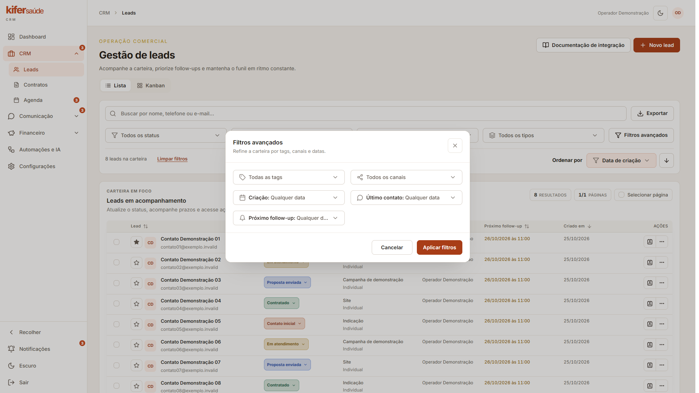
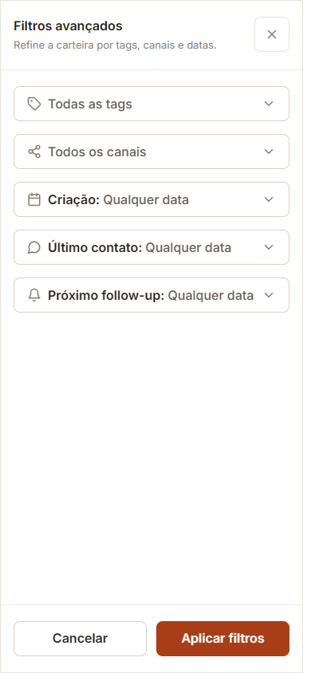

# Revisão visual — filtros avançados de Leads

**Status: comparado com as referências, com adaptação aos filtros realmente disponíveis no CRM.** A rota continua sendo `/painel/leads`; não foi criada uma página de filtros independente.

## Referências

- [Listagem de filtros avançados — desktop](../../../references/desktop/extra--leads-filtros-avancados.png)
- [Listagem de filtros avançados — mobile](../../../references/mobile/extra--leads-filtros-avancados.png)
- [Diálogo de filtros — desktop](../../../references/desktop/state--leads-filtros-avancados.png)
- [Diálogo de filtros — mobile](../../../references/mobile/state--leads-filtros-avancados.png)

## Padrão aplicado

- Os filtros rápidos de status, responsável, origem e tipo permanecem na listagem, junto da busca existente.
- “Filtros avançados” abre um `Dialog` no desktop e um `Drawer` de tela cheia no mobile, usando os componentes reais do design system.
- O painel mantém os cinco critérios avançados suportados: tags, canais, criação, último contato e próximo follow-up. A referência apresenta alguns critérios que não existem separadamente no CRM; eles não foram inventados.
- As escolhas ficam em rascunho. **Aplicar filtros** confirma os valores; **Cancelar**, o botão de fechar ou Escape descartam as alterações pendentes. O contador da listagem mostra os critérios ativos.
- Os seletores de data e hora continuam funcionando dentro do painel. Escape fecha o diálogo e devolve o foco ao botão que o abriu.

## Capturas

Há **6 screenshots**: desktop claro e escuro, tablet, mobile em 390 px, mobile em 320 px e o popover de intervalo de datas no mobile. As capturas registram a janela visível para inspecionar a composição do diálogo/drawer; medições e verificações estão em [`coverage.json`](coverage.json).

## Verificação

Playwright confirmou a abertura responsiva, o popover de datas, Cancelar sem aplicar mudanças, Aplicar atualizando o contador, Escape com retorno de foco e ausência de overflow horizontal em 320, 390, 768 e 1920 px. A validação utilizou apenas os registros sintéticos de demonstração e não salvou dados nem acionou serviços externos. A suíte completa passou **1.733/1.733 testes em 328 arquivos**; typecheck, lint, arquitetura, migrations, auditorias e build também passaram. O bundle mantém o aviso conhecido de chunk vendor acima de 500 kB. Após recarregar a página, não houve erro de renderização do painel; permanece um aviso de ciclo de vida legado emitido por `react-side-effect` no ambiente de desenvolvimento.

